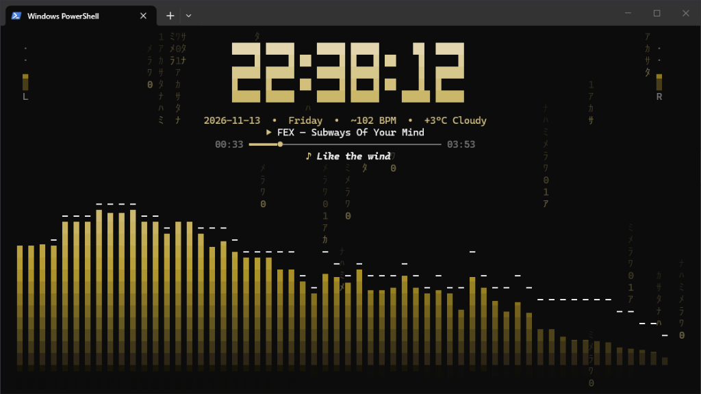

<div align="center">

# spectrum-clock

**Real-time terminal audio spectrum analyzer, clock, and synced lyrics viewer in Rust**

[](https://www.rust-lang.org/)
[](LICENSE)
[](#requirements)

**English** · [Русский](README.ru.md)

</div>

---

<div align="center">



</div>

Built with [`ratatui`](https://ratatui.rs/), [`rustfft`](https://crates.io/crates/rustfft), and [`cpal`](https://crates.io/crates/cpal). Designed primarily for **Windows Terminal** (WASAPI loopback capture + Windows Media Session integration), with cross-platform audio fallback.

---

## Highlights

| Category | What's Included |
| --- | --- |
| **Visualizations (`M`)** | `Bars`, `Mirror`, `Waveform`, `Waterfall`, `Circle`, `Horizon`, `Lissajous` |
| **Themes (`T`)** | `Cover` (adaptive album art palette), `Cyberpunk`, `Synthwave`, `Neon`, `Rainbow`, `Matrix`, `Fire`, `Ocean`, `System` + custom `themes.conf` |
| **Clock Fonts (`F`)** | `Block`, `Neon`, `Segment`, `Dots` + Clock / Pomodoro / Stopwatch (`W`) + Alarm (`N`) |
| **Background FX (`B`)** | `Stars`, `Matrix`, `Aurora`, `Pulse`, `Fire`, `Off` |
| **Lyrics (`Y`)** | Cycles `1-line` → `3-line karaoke` → `Full-screen Lyrics Mode` via [`lrclib.net`](https://lrclib.net) (`.lrc` + `plainLyrics` fallback) |
| **Now Playing** | Windows SMTC track info, progress bar, 12×6 pixel cover art (`I`), media keys (`Space`, `←`, `→`) |
| **Smart Idle & Weather** | **Weather (`K`)** via `wttr.in` every 30 min · **Idle Sleep (`L`)** hides spectrum after 15s of silence |
| **Audio & Polish** | 2048-pt FFT (`Full` / `Bass` / `Mids`), Auto-Gain (`A`), L/R VU meters, BPM, Water reflection (`R`), OLED drift (`O`), Compact (`C`), Zen (`Z`) |

---

## Quick Start

### Requirements

- **Rust** (Edition 2024, e.g. Rust 1.85+)
- A terminal with **TrueColor (24-bit RGB)** and Unicode support (Windows Terminal recommended)

### Run from Source

```bash
git clone https://github.com/xanax01d/spectrum-clock.git
cd spectrum-clock
cargo run --release
```

<details>
<summary>Development checks (clippy &amp; unit tests)</summary>

```bash
cargo clippy --all-targets -- -D warnings
cargo test
```

</details>

---

## Controls

| Key | Action | Key | Action |
| :---: | --- | :---: | --- |
| `T` | Cycle color theme | `Space` | Play / Pause media |
| `M` | Cycle spectrum mode | `←` / `→` | Previous / Next track |
| `F` | Cycle clock font | `+` / `-` · `↑` / `↓` | Adjust gain |
| `B` | Cycle background FX | `A` | Toggle Auto-Gain (AGC) |
| `Y` | Cycle lyrics (`1L` / `3L` / `Full`) | `Enter` | Reset Pomodoro / Stopwatch |
| `W` | Clock / Pomodoro / Stopwatch | `X` | Toggle Party shuffle |
| `I` | Toggle album cover art | `S` | Toggle seconds |
| `R` | Toggle water reflection | `D` | Cycle bar density |
| `E` | Cycle frequency range | `N` | Dismiss active alarm |
| `O` | Toggle OLED pixel drift | `P` | Freeze / Pause spectrum |
| `C` | Toggle compact widget mode | `K` | Toggle weather display |
| `Z` | Toggle Zen auto-hide footer | `L` | Toggle Idle Sleep |
| `?` / `H` | Toggle help overlay | `Q` / `Esc` | Quit |

---

## Configuration

Settings persist automatically in `config.conf`:

- **Windows**: `%APPDATA%\spectrum-clock\config.conf`
- **Linux / macOS**: `~/.config/spectrum-clock/config.conf`

Full reference for all keys, alarm syntax (`HH:MM|Message`), `weather_city`, and custom `themes.conf` palettes is in **[docs/CONFIGURATION.md](docs/CONFIGURATION.md)**.

---

<details>
<summary>Project Architecture</summary>

| Module | Responsibility |
| --- | --- |
| `src/main.rs` | Event loop, input handling, module coordination, config persistence |
| `src/audio.rs` | WASAPI loopback (Windows) and `cpal` audio capture |
| `src/fft.rs` | 2048-point FFT analyzer, AGC, bass pulse, and BPM estimation |
| `src/ui.rs` | `ratatui` layout, 7 spectrum modes, Lyrics Mode, VU meters, overlays |
| `src/clock.rs` | 4 big clock fonts, Pomodoro timer, and stopwatch |
| `src/theme.rs` | Built-in palettes, system accent detection, custom `themes.conf` parser |
| `src/particles.rs` | Animated background effect engine |
| `src/now_playing.rs` | Windows SMTC integration and album cover palette extraction |
| `src/lyrics.rs` | Background `.lrc` / `plainLyrics` fetcher (`lrclib.net`) |
| `src/weather.rs` | Background weather poller (`wttr.in`) |
| `src/config.rs` | `config.conf` and `themes.conf` serialization and parsing |

</details>

## License

Distributed under the **[MIT License](LICENSE)**.
